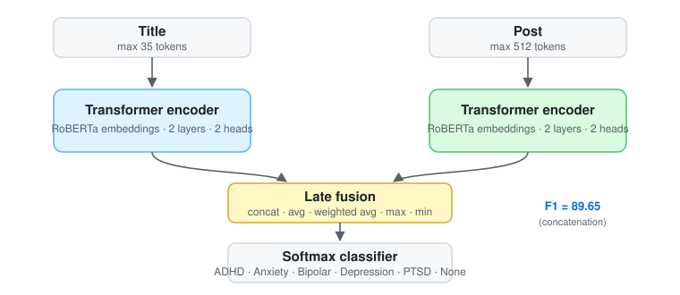

<div align="center">

# Mental Illness Classification on Social Media Texts
### Deep Learning and Transfer Learning with Late-Fusion Transformers

[%202024-1f6feb)](https://doi.org/10.13053/CyS-28-2-4873)
[](https://doi.org/10.13053/CyS-28-2-4873)
[](#installation)
[](LICENSE)
[](https://github.com/marif561/Mental-Illness-Social-Media/actions/workflows/tests.yml)

Code and results for **"Mental Illness Classification on Social Media Texts Using Deep Learning and Transfer Learning"**, *Computación y Sistemas*, Vol. 28, No. 2, 2024, pp. 451–464.

**Muhammad Arif**¹ · Iqra Ameer² · Necva Bölücü³ · Grigori Sidorov¹ · Alexander Gelbukh¹ · Vinnayak Elangovan²

¹ Centro de Investigación en Computación, Instituto Politécnico Nacional, Mexico · ² Penn State Abington, USA · ³ CSIRO Data61, Australia

</div>

---

## About the paper

Millions of people now turn to social media to talk about their mental health. This paper classifies Reddit posts into five common mental illnesses — **ADHD, anxiety, bipolar disorder, depression and PTSD** — or **none**. Each Reddit post has a short **title** and a longer **body**. We encode each text with its own Transformer encoder and merge them through **late fusion**, comparing five fusion strategies against classical machine learning, deep learning and pretrained language models. The Transformer with **concatenation** fusion reaches a micro-F1 of **89.65**, ahead of the previous best RoBERTa model (89.0).

<p align="center">
  
</p>

## Highlights

- 🧠 Six-way classification of Reddit posts: ADHD · Anxiety · Bipolar · Depression · PTSD · None
- 🔀 Title and body each go through a separate Transformer encoder, then are merged by late fusion
- 🧪 Compared with 4 classical ML, 3 deep learning and 3 pretrained-transformer baselines
- 🏆 **Concatenation fusion: P 89.86 · R 89.58 · F1 89.65**, the best of all methods
- 📝 Using both texts beats either one alone (title-only F1 70.09, post-only F1 83.63)

## Dataset

Reddit mental-illness benchmark by [Murarka et al. (2021)](https://aclanthology.org/2021.louhi-1.7/): 16,703 posts, each with a title, body and one label.

| Class | Train | Dev | Test |
|---|---:|---:|---:|
| ADHD | 2,465 | 248 | 248 |
| Anxiety | 2,422 | 248 | 248 |
| Bipolar | 2,407 | 248 | 248 |
| Depression | 2,450 | 248 | 248 |
| PTSD | 2,001 | 248 | 248 |
| None | 1,982 | 248 | 248 |
| **Total** | **13,727** | **1,488** | **1,488** |

The data belongs to its original authors and is not redistributed here. See [`data/README.md`](data/README.md) for the expected format.

## Results

All scores are micro-averaged on the test set.

### Main comparison (title + post for the proposed model)

| Family | Model | F1 | Precision | Recall |
|---|---|:-:|:-:|:-:|
| **Proposed** | **Transformer + concatenation fusion** | **89.65** | **89.86** | **89.58** |
| Prior SOTA | RoBERTa (Murarka et al., 2021) | 89.00 | 89.00 | 89.00 |
| Classical ML | LinearSVC | 77.18 | 77.66 | 77.15 |
| | Logistic Regression | 77.87 | 78.24 | 77.89 |
| | Multinomial NB | 66.49 | 72.18 | 66.73 |
| | Random Forest | 70.85 | 72.46 | 70.50 |
| Deep learning | CNN | 81.64 | 82.84 | 82.65 |
| | LSTM | 83.73 | 84.10 | 83.60 |
| | BiLSTM | 83.84 | 84.06 | 83.74 |
| Transfer learning | BERT | 80.82 | 80.87 | 80.85 |
| | ALBERT | 80.45 | 80.90 | 80.38 |
| | RoBERTa | 84.41 | 85.10 | 84.41 |

Baselines are trained on the post text.

### Late-fusion strategies

| Fusion | Precision | Recall | F1 |
|---|:-:|:-:|:-:|
| **Concatenation** | **89.86** | **89.58** | **89.65** |
| Minimum | 88.04 | 87.84 | 87.86 |
| Average | 88.06 | 87.70 | 87.78 |
| Maximum | 87.81 | 87.50 | 87.60 |
| Weighted average | 86.68 | 85.69 | 85.85 |

### Title vs. post vs. both (Transformer, per-class F1)

| Class | Title | Post | Title + Post |
|---|:-:|:-:|:-:|
| ADHD | 72 | 86 | **92** |
| Anxiety | 64 | 77 | **86** |
| Bipolar | 59 | 80 | **87** |
| Depression | 67 | 78 | **85** |
| PTSD | 66 | 84 | **85** |
| None | 92 | **96** | 85 |

Values as printed in the paper's Table 8. The class-wise late-fusion table (Table 9) gives concatenation F1 of 89 for PTSD and 99 for None, so the two tables disagree on those cells. Combining title and post helps every illness class. The remaining errors are mostly between anxiety, bipolar, depression and PTSD, which share vocabulary. The confusion matrix and all other tables are in [`results/`](results/).

## Repository structure

```
.
├── configs/                 # Hyperparameters from the paper (Table 3)
├── data/                    # Expected format + tiny invented sample
├── docs/figures/            # Architecture diagram
├── results/                 # All paper tables as CSV
├── scripts/run_all.sh       # Reproduce every experiment
├── tests/                   # Unit tests (CI on every push)
└── src/mentalnlp/
    ├── data.py              # Loading, label mapping, title/post fields
    ├── metrics.py           # Micro / macro P-R-F1, confusion matrix
    ├── baselines_ml.py      # TF-IDF word 1–3-grams + LinearSVC / LR / NB / RF
    ├── models.py            # Transformer encoder, late fusion, CNN / LSTM / BiLSTM
    ├── train.py             # Train the proposed model and DL baselines
    └── train_plm.py         # Fine-tune BERT / ALBERT / RoBERTa
```

## Installation

```bash
git clone https://github.com/marif561/Mental-Illness-Social-Media.git
cd Mental-Illness-Social-Media
python -m venv .venv && source .venv/bin/activate
pip install -r requirements.txt
pip install -e .
```

## Usage

```bash
# Proposed model: title + post with concatenation late fusion
python -m mentalnlp.train --data-dir data/reddit --model transformer --field both --fusion concat

# Other fusion strategies: avg | wavg | max | min
python -m mentalnlp.train --data-dir data/reddit --model transformer --field both --fusion min

# Single-text runs and deep-learning baselines
python -m mentalnlp.train --data-dir data/reddit --model transformer --field post
python -m mentalnlp.train --data-dir data/reddit --model bilstm --field post

# Classical ML (TF-IDF word 1–3-grams, 1,000 features)
python -m mentalnlp.baselines_ml --data-dir data/reddit --field post

# Pretrained language models
python -m mentalnlp.train_plm --data-dir data/reddit --model roberta-base --field post
```

Or run everything with `bash scripts/run_all.sh data/reddit`. Each run writes metrics, the confusion matrix and predictions to `outputs/`.

> **Note.** `src/` is a clean reference implementation of the models and settings in the paper. Exact scores can differ slightly with hardware, library versions and seeds. Some Table 3 values look like typesetting errors, such as `d_model = 2`. Those are flagged in [`configs/transformer.yaml`](configs/transformer.yaml).

## Responsible use

This is a research tool for studying language patterns at the population level. It is **not** a diagnostic instrument and should not be used to label or make decisions about individuals. Mental-health conditions can only be diagnosed by qualified professionals.

## Citation

```bibtex
@article{arif2024mental,
  title   = {Mental Illness Classification on Social Media Texts Using Deep Learning and Transfer Learning},
  author  = {Arif, Muhammad and Ameer, Iqra and B{\"o}l{\"u}c{\"u}, Necva and Sidorov, Grigori and
             Gelbukh, Alexander and Elangovan, Vinnayak},
  journal = {Computaci{\'o}n y Sistemas},
  volume  = {28},
  number  = {2},
  pages   = {451--464},
  year    = {2024},
  doi     = {10.13053/CyS-28-2-4873}
}
```

## Acknowledgements

Partially supported by CONACYT grant A1-S-47854, SIP-IPN grants 20241816, 20241819 and 20240951, the CONACYT Deep Learning Platform at INAOE, and the Microsoft Latin America PhD Award.

## License

Code is released under the [MIT License](LICENSE). The dataset is subject to its original authors' terms.
